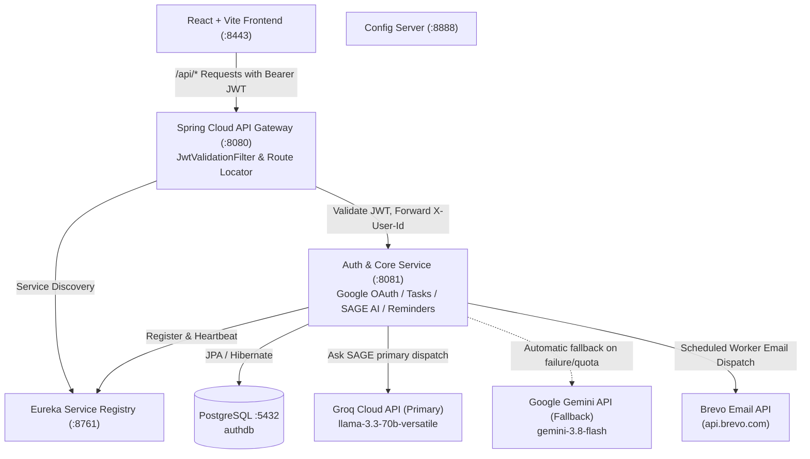

# SAGE — Smart Academic & Growth Engine

> A personal productivity and progress assistant designed specifically for university students, unifying academic timetables, impending assignment deadlines, exams, coding contest tracking, and AI-powered decision support.

---

## 1. Problem Statement & Key Objectives

University students routinely navigate multiple disjointed channels: course learning systems, assignment deadlines, exam timetables, Google Calendar events, and competitive programming rounds across LeetCode, Codeforces, CodeChef, and AtCoder.

The fundamental student bottleneck is not a lack of items to do, but **decision fatigue**: deciding what specific task to focus on right now with the fragmented time available.

**SAGE provides:**
1. **Real Data Task Management**: Persisted in PostgreSQL with priorities, estimated effort, categories, and deadlines.
2. **Context-Aware Decision Engine**: Recommends the optimal single focus item based on impending deadlines and available study windows.
3. **Ask SAGE (AI-Powered Assistant)**: Real AI chat completion grounded in the student's actual database profile and pending tasks using **Groq** (`llama-3.3-70b-versatile` & `llama-3.2-11b-vision-preview`) as primary and **Google Gemini** (`gemini-3.8-flash`) as automatic fallback.
4. **Reliable Email Reminders**: PostgreSQL persistence with an automated Spring background scheduler dispatching alerts via Brevo / Resend.
5. **Unified Contest Tracking**: Seamless scheduling of upcoming rounds with customizable lead alerts (`10m`, `30m`, `1h`, `1d`) and automated deduplication.
6. **Focus Mode**: Distraction-free timer connected directly to priority tasks.
7. **Strict Multi-User Isolation & Privacy**: User-scoped storage, server-side JWT verification at the gateway, and transactional permanent account deletion.

---

## 2. Architecture & Request Flow

SAGE is built on a Service-Oriented Architecture (SOA) with a reactive Spring Cloud Gateway fronting backend microservices and a React + Vite frontend.



### Request Flow
1. **Authentication**: Client completes Google Identity Services (GIS) flow or development login, receiving a signed HMAC-SHA256 JWT from `auth-service`.
2. **Gateway Verification**: Every protected request through `api-gateway` (:8080) passes through `JwtValidationFilter`, which cryptographically validates the token, extracts the user ID, sanitizes incoming headers, and injects `X-User-Id`, `X-User-Email`, and `X-User-Role` downstream.
3. **Ask SAGE Flow**: `POST /api/sage/ask` reaches `auth-service`, resolves the authenticated user, queries active pending tasks from PostgreSQL, constructs a grounded system prompt, and calls primary provider **Groq Cloud** (`llama-3.3-70b-versatile` / `llama-3.2-11b-vision-preview`). If Groq fails, encounters quota limits (429), or is not configured, it automatically falls back to **Google Gemini** (`gemini-3.8-flash`).
4. **Email Reminders Flow**: Reminders are saved to PostgreSQL via `POST /api/reminders`. A background `@Scheduled` worker scans for due reminders, checks quiet hours and user timezones, formats responsive HTML templates, dispatches via Brevo, and records delivery status idempotently.

---

## 3. Technology Stack

| Layer | Technology | Purpose |
| :--- | :--- | :--- |
| **Frontend Framework** | React 19, TypeScript 5.7, Vite 8 | Component lifecycle, responsive UI, sub-second HMR |
| **Frontend UI System** | Microsoft Fluent UI v9 & Tailwind CSS 4 | Enterprise accessible UI components, typography, tokens |
| **Service Registry** | Spring Cloud Netflix Eureka Server | Microservice registration and dynamic discovery (:8761) |
| **API Gateway** | Spring Cloud Gateway (Reactive / WebFlux) | Central reverse proxy, route routing, JWT security (:8080) |
| **Backend Core** | Spring Boot 4.1 / Spring 7, Java 21 | REST APIs, JPA repositories, scheduled background workers (:8081) |
| **Database** | PostgreSQL 16+ | Relational persistence (`users`, `tasks`, `reminders`, `deleted_accounts`) |
| **Primary AI Provider** | Groq Cloud API (`llama-3.3-70b-versatile`) | Ultra-fast grounded student reasoning & vision via Spring `RestClient` |
| **Fallback AI Provider** | Google Gemini API (`gemini-3.8-flash`) | Automatic resilient secondary AI provider |
| **Email Provider** | Brevo Transactional Email API (`api.brevo.com`) | Transactional deadline reminder dispatch |

---

## 4. Repository Structure

```
soa/
├── .env.example                               # Unified environment configuration template
├── README.md                                  # Repository documentation & runbook
├── DEVELOPMENT_LOG.md                         # Detailed work history, status matrix & test logs
├── start-soa.bat                              # One-click Windows startup script
├── stop-soa.bat                               # Clean shutdown script
├── eureka-server/                             # Service Registry (:8761)
├── config-server/                             # Centralized Config Server (:8888)
├── api-gateway/                               # Spring Cloud Gateway (:8080)
│   └── src/main/java/api_gateway/             # JwtValidationFilter, GatewayConfig
├── auth-service/                              # Core Service (:8081)
│   └── src/main/java/auth_service/
│       ├── config/                            # SecurityConfig, JwtUtils
│       ├── controller/                        # AuthController, ReminderController
│       ├── model/                             # User, Task, Reminder, DeletedAccount
│       ├── repository/                        # UserRepository, TaskRepository, ReminderRepository
│       └── service/                           # GroqAiService, GeminiAiService, BrevoEmailService, ResendEmailService, ReminderSchedulerService
├── Design SAGE Productivity Platform/         # React Frontend (:8443 / :5173)
│   ├── src/
│   │   ├── api/client.ts                      # Centralized API client with JWT attachment
│   │   ├── services/sageService.ts            # Ask SAGE client adapter
│   │   ├── services/reminderService.ts        # PostgreSQL reminder sync client
│   │   ├── notifications.ts                   # In-browser notification & offset engine
│   │   └── userStorage.ts                     # User-scoped isolated localStorage engine
│   └── vite.config.ts                         # Dev proxy to Gateway (:8080) and contest scraper
└── [calendar-service, notification-service,   # Reserved architectural stubs (.gitkeep)
     profile-service, sage-brain]
```

---

## 5. Prerequisites & Environment Setup

### Prerequisites
- **Java**: JDK 21+ (`java -version`)
- **Node.js**: v20+ or v22+ (`node -v`)
- **Package Manager**: `pnpm` or `npm`
- **PostgreSQL**: Running on port `5432` with database `authdb`
- **Maven**: Included via `mvnw.cmd` in each service directory

### Environment Variables Configuration

Copy `.env.example` to `.env` in the project root:

```bash
cp .env.example .env
```

| Variable | Service | Required For | Default / Example |
| :--- | :--- | :--- | :--- |
| `SPRING_DATASOURCE_URL` | `auth-service` | PostgreSQL connection | `jdbc:postgresql://localhost:5432/authdb` |
| `SPRING_DATASOURCE_USERNAME` | `auth-service` | DB username | `postgres` |
| `SPRING_DATASOURCE_PASSWORD` | `auth-service` | DB password | `postgres` |
| `JWT_SECRET` | `api-gateway`, `auth-service` | Signing & verifying JWTs | `sage-secret-key-super-secure-at-least-32-bytes-long` |
| `GOOGLE_CLIENT_ID` | `auth-service`, `frontend` | Google GIS Token verification | `your-id.apps.googleusercontent.com` |
| `GEMINI_API_KEY` | `auth-service` | Google Gemini AI completions | `AQ...` (Get from https://aistudio.google.com/) |
| `GEMINI_MODEL` | `auth-service` | Gemini model identifier | `gemini-3.8-flash` |
| `GEMINI_TIMEOUT_SECONDS` | `auth-service` | Request timeout in seconds | `25` |
| `RESEND_API_KEY` | `auth-service` | Email reminder dispatch | `re_...` (Get from https://resend.com/) |
| `EMAIL_FROM` | `auth-service` | Verified sender address | `SAGE <onboarding@resend.dev>` |
| `REMINDER_WORKER_ENABLED` | `auth-service` | Background scheduler toggle | `true` |
| `REMINDER_WORKER_INTERVAL_MS`| `auth-service` | Scan interval in ms | `30000` (every 30 seconds) |

> **Security Note**: Never expose `GEMINI_API_KEY`, `RESEND_API_KEY`, `SPRING_DATASOURCE_PASSWORD`, or `JWT_SECRET` in frontend code or with the `VITE_` prefix. Credentials are maintained strictly on the backend.

---

## 6. Startup & Shutdown Instructions

### One-Click Windows Launch
Run `start-soa.bat` from the repository root:
```cmd
start-soa.bat
```
This starts the platform in strict dependency order:
1. `config-server` (:8888)
2. `eureka-server` (:8761)
3. `auth-service` (:8081)
4. `api-gateway` (:8080)
5. `Design SAGE Productivity Platform` (:8443)

### One-Click Windows Shutdown
```cmd
stop-soa.bat
```
Terminates all SAGE processes cleanly by port numbers (8080, 8081, 8443, 8761, 8888) without affecting other development applications.

---

## 7. API Endpoints & Authentication Requirements

All protected endpoints require an `Authorization: Bearer <JWT>` header or `X-User-Id` injected by `api-gateway`.

### Authentication & Account
- `POST /api/auth/google`: Exchanges Google GIS ID token for authenticated session & JWT.
- `GET /api/auth/me`: Retrieves current user profile and onboarding status.
- `POST /api/auth/onboarding`: Completes student calibration wizard.
- `DELETE /api/auth/account`: Permanently deletes account, cascading to all tasks and reminders, and creates a tombstone record.

### Tasks
- `GET /api/tasks`: Returns all tasks for the authenticated user.
- `POST /api/tasks`: Creates a new task.
- `PATCH /api/tasks/{id}`: Updates task status, priority, or deadline.
- `DELETE /api/tasks/{id}`: Deletes a task.

### Ask SAGE (Multimodal AI-Powered Assistant)
- `POST /api/sage/ask`: Dispatches student queries and optional document/image attachments to Google Gemini, grounded in the user's active database tasks, schedule, and timezone.
  - Supports image and PDF attachments (`image/png`, `image/jpeg`, `image/webp`, `image/gif`, `application/pdf`) encoded via official Gemini `inline_data` parts.
  - Parses forwarded college announcements and circulars, extracting structured task candidates (`title`, `dueDate`, `dueTime`, `priority`, `sourceSnippet`, `confidence`, `isAmbiguous`).
  - Resolves relative deadlines ("tomorrow at 5 PM", "next Monday") anchored to user calendar date and local timezone (`Asia/Kolkata`).
  - Parses timetable schedule uploads, providing a conflict-aware preview that detects existing duplicates and room/period collisions before importing.
  - Returns: `{ message, reply, action, reasoning, pendingTasksCount, totalMinutes, topTaskId, topTaskTitle, responseId, model, provider }`.
  - When `GEMINI_API_KEY` is not set: Returns HTTP 503 explaining that credentials are required (never fakes a response).
  - Handles rate limits (HTTP 429), timeouts (HTTP 504), and upstream errors (HTTP 502) gracefully.

### Email Reminders
- `GET /api/reminders`: Lists all reminders for the authenticated student.
- `POST /api/reminders`: Creates or updates a reminder (deduplicating contest reminders by `contestId`).
- `PATCH /api/reminders/{id}`: Reschedules or updates status (`completed`, `snoozed`, `dismissed`).
- `DELETE /api/reminders/{id}`: Deletes a reminder.
- `POST /api/reminders/test-email`: Triggers a single verified test reminder email to the authenticated user via Resend.

---

## 8. Verification & Test Evidence

### Backend Test Suites
```bash
# In auth-service:
cd auth-service
.\mvnw.cmd test
# Output: 35 tests run, 0 failures, 0 errors (AskSageTests: 14/14, ReminderServiceTests: 7/7, GoogleAuthExchangeTests: 13/13, AuthServiceApplicationTests: 1/1)

# In api-gateway:
cd ..\api-gateway
.\mvnw.cmd test
# Output: 20 tests run, 0 failures, 0 errors (ApiGatewayApplicationTests)
```

### Frontend Test Suites & Build
```bash
# In Design SAGE Productivity Platform:
cd "Design SAGE Productivity Platform"

# Run Unit Tests
npm test
# Output: 27 tests pass across askSageChatbot.test.ts, askSage.test.ts, reminders.test.ts, timetable.test.ts, deletion.test.ts

# Production Bundle Build
npm run build
# Output: Successfully built dist/ with zero errors
```

---

## 9. Developer diagnostics and local logs

Open `http://localhost:8443/dev/diagnostics` while running the Vite development server. It records sanitized browser runtime errors, unhandled promise rejections, React render failures, failed API calls, timings, response request IDs, and actual development health probes. Use search, severity filtering, copy, clear, or **Export sanitized JSON**. The page deliberately does **not** read backend logs, and a browser network error can only indicate a suspected CORS/connectivity failure—not prove its root cause.

All active services write bounded local files under `logs/`: `frontend.log`, `api-gateway.log`, `auth-service.log`, `eureka-server.log`, and `config-server.log`. Java logs rotate at 10 MB with 14 days / 1 GB retention; the frontend stream retains 14 local rotations. Run:

```powershell
powershell -ExecutionPolicy Bypass -File scripts\View-SageLogs.ps1
# Search all service logs for a request ID
Select-String '<request-id>' .\logs\*.log
```

The frontend creates an `X-Request-Id` per API request. The gateway accepts only UUIDv4-shaped IDs and replaces invalid values, propagates the result downstream, logs it, and returns it in error responses. Match that value from the dashboard to `logs/api-gateway.log` and `logs/auth-service.log`.

Default production logging is INFO. Set `SAGE_AUTH_LOG_LEVEL`, `SAGE_GATEWAY_LOG_LEVEL`, `SAGE_CONFIG_LOG_LEVEL`, or `SAGE_EUREKA_LOG_LEVEL` to `DEBUG`/`TRACE` only for a limited local troubleshooting session. Never enable SQL bind-value logging or log credentials, JWTs, cookies, OAuth credentials, API keys, or request bodies.

For diagnosis: gateway failures appear in `api-gateway.log`; PostgreSQL/Hikari/JPA failures in `auth-service.log`; Gemini entries use `event=gemini_failure` with safe categories (quota, timeout, authentication); Google sign-in entries use `event=google_token_verification_failed`; and reminder delivery uses `event=email_delivery_failure`. Health checks are read-only and never invoke Gemini, email delivery, or data mutations. Only `/actuator/health` is exposed with no component details; there is no log-reading HTTP endpoint.

## 10. Known Limitations & Future Improvements

1. **AI Provider Key Dependency**:
   - Live AI queries require an active `GEMINI_API_KEY`. If unconfigured, SAGE returns an honest, graceful HTTP 503 error without fabricating mock outputs.
2. **Resend Free Tier Sender Domain**:
   - The default `onboarding@resend.dev` sender address in Resend's free tier only delivers to the email account registered with Resend. For delivering to arbitrary student domains (`@college.edu`), verify a custom domain in Resend DNS.
3. **Microservice Splitting (Post-48h)**:
   - `calendar-service`, `notification-service`, `profile-service`, and `sage-brain` are currently stubs with core capabilities centralized in `auth-service`. As traffic scales, these can be split into standalone services using the existing Eureka registry.
